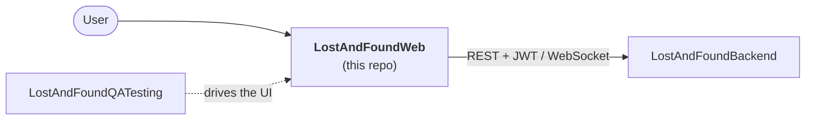

# 🧭 Lost & Found Nepal: Web (Frontend)

The React frontend for **Lost & Found Nepal**, a web app where people report lost items, post found items, and claim belongings back.

🌐 **Live site:** [lostandfoundnepal.pages.dev](https://lostandfoundnepal.com)

> **A personal project.** I built this on my own to practise full-stack development. It isn't a commercial product and isn't affiliated with any organisation.


---

## 🔗 Part of a 3-repo project

| Repo | Role | |
|---|---|---|
| **LostAndFoundWeb** | Frontend (React) | 👈 *you are here* |
| [LostAndFoundBackend](https://github.com/maheshzrawal333/LostAndFoundBackend) | Spring Boot API, auth, database, images, email | Serves this app |
| [LostAndFoundQATesting](https://github.com/maheshzrawal333/LostAndFoundQATesting) | Selenium + TestNG end-to-end tests | Tests this app |



**This app needs the backend to be useful.** All data, login, image storage and notifications come from [LostAndFoundBackend](https://github.com/maheshzrawal333/LostAndFoundBackend). Start it first when running locally.

## ✨ Features

- 🔐 Sign up and log in (JWT-based auth, handled through a React context)
- 📝 Report a **lost** or **found** item
- 🙋 Claim an item that has been found
- 🖼️ Photo upload with client-side compression before it goes to the backend
- ⚡ Live updates over WebSocket (STOMP via SockJS)
- 📱 Responsive layout with Tailwind CSS

## 🧰 Tech stack

| Area | Tools |
|---|---|
| Framework | React 19, TypeScript |
| Build tool | Vite |
| Styling | Tailwind CSS, PostCSS, Autoprefixer |
| HTTP | Axios |
| Real-time | `@stomp/stompjs`, `sockjs-client` |
| Images | `browser-image-compression` |
| Code quality | ESLint (with React Hooks and React Refresh plugins) |

## 🚀 Getting started

**Requirements:** Node.js 20.19+ (or 22+) and npm. A running instance of the [backend](https://github.com/maheshzrawal333/LostAndFoundBackend).

```bash
git clone https://github.com/maheshzrawal333/LostAndFoundWeb.git
cd LostAndFoundWeb
npm install
npm run dev
```

Vite prints the local URL (usually `http://localhost:5173`).

### Connecting to the backend

Point the API client at your backend URL. The HTTP client lives in `src/services/apiClient.ts`, and the WebSocket connection should target the same backend host.

If the browser blocks requests with a CORS error, make sure your local frontend origin is allowed in the backend's CORS configuration.

### Scripts

| Command | What it does |
|---|---|
| `npm run dev` | Start the dev server with hot reload |
| `npm run build` | Create a production build |
| `npm run preview` | Preview the production build locally |
| `npm run lint` | Run ESLint |

## 📁 Project structure

```
lost-and-found-web/
├── src/
│   ├── assets/
│   ├── components/
│   │   ├── common/        # Button, Modal, Input
│   │   ├── items/         # ItemCard, ReportModal, ClaimModal
│   │   └── layout/        # Navbar
│   ├── context/           # AuthContext (login state)
│   ├── services/          # apiClient, itemService (talks to the backend)
│   ├── types/             # item.types (shared TypeScript types)
│   ├── App.tsx
│   ├── main.tsx
│   └── index.css
├── package.json
└── tsconfig.json
```

## 🧪 Testing

There are no unit tests in this repo. The app is covered by browser-based end-to-end tests in
[**LostAndFoundQATesting**](https://github.com/maheshzrawal333/LostAndFoundQATesting), which drive this UI with Selenium.

If you rename buttons, labels or page elements here, check that the QA tests' locators still match.

The [backend repo](https://github.com/maheshzrawal333/LostAndFoundBackend) also has **Postman API tests** for the API this app depends on. If something looks broken in the UI, running those first shows whether the API is the cause.

## ☁️ Deployment

Hosted on **Cloudflare Pages** at [lostandfoundnepal.com](https://lostandfoundnepal.com).

Typical Vite settings for Pages are build command `npm run build` and output directory `dist`. The deployed site talks to the production backend, which runs as a Docker container (see the [backend repo](https://github.com/maheshzrawal333/LostAndFoundBackend)).

> ⏳ If the backend is on a free tier, the first request after a quiet period may be slow while it wakes up.

## 📄 License & usage

Personal project with no open-source license applied yet. You're welcome to read the code and learn from it. If you'd like to reuse any of it, please get in touch first.

## 👤 Author

Built by **[@maheshzrawal333](https://github.com/maheshzrawal333)**. Issues and ideas are welcome.
